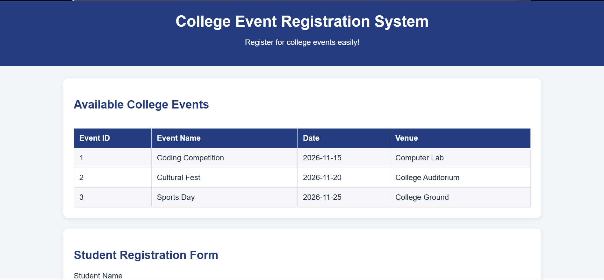
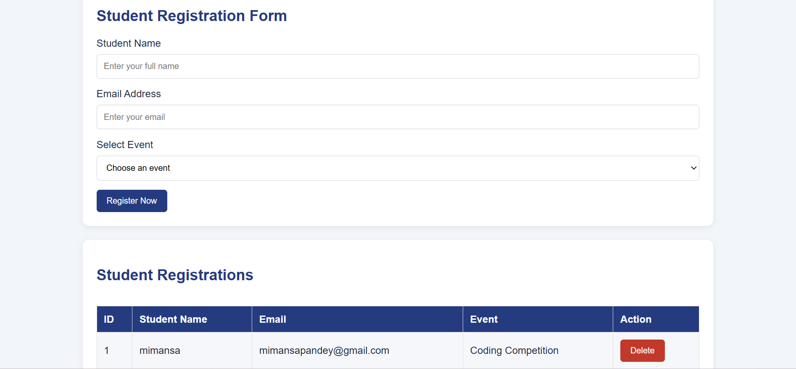

# 🎓 College Event Registration System

**A Database Management Systems (DBMS) Project**

The College Event Registration System is a web-based application developed to automate and simplify the process of registering students for college events. It provides a centralized platform where students can browse upcoming events, register online, and manage their registrations.

The project uses Python Flask for backend development and SQLite for database management.

---

## 📌 Project Overview

The main objective of this project is to replace manual event registration processes with an automated, centralized, and reliable web-based system.

### Objectives
- Automate student event registration.
- Centralize event details and participant records.
- Reduce data redundancy.
- Maintain data integrity using primary and foreign keys.
- Provide a simple and user-friendly interface for students and administrators.

---

## 🚀 Key Features

- **Event Announcement:** Admins can publish events with details and eligibility requirements.
- **Event Browsing:** Students can view available events and their details.
- **Online Registration:** Students can register for events using their name and email.
- **Data Validation:** Validates registration entries and maintains data integrity.
- **Registration Dashboard:** Displays active registrations.
- **Registration Management:** Allows registration records to be updated or deleted.
- **Database Integration:** Stores event and registration information using SQLite.

---

## 🛠️ Technology Stack

| Technology | Purpose |
|---|---|
| Python | Backend programming |
| Flask | Web application framework |
| SQLite | Relational database |
| HTML5 | Web page structure |
| CSS3 | Styling and design |
| Jinja2 | Dynamic HTML templates |
| sqlite3 | Python–SQLite connectivity |

---

## 🗄️ Database Design

The project uses a relational database with two main tables:

### 1. Events Table

Stores information about college events.

| Column | Description |
|---|---|
| event_id | Primary Key |
| event_title | Name of the event |
| event_date | Date of the event |
| description | Event details |
| location | Event venue |
| created_at | Record creation timestamp |

### 2. Registrations Table

Stores student registration information.

| Column | Description |
|---|---|
| registration_id | Primary Key |
| student_name | Student's name |
| email | Student's email |
| event_id | Foreign Key |
| registered_at | Registration timestamp |
| status | Registration status |

### Database Relationship

- One event can have multiple registrations.
- Each registration is linked to a valid event.
- Primary keys uniquely identify records.
- Foreign keys maintain referential integrity.

**Relationship:** One-to-Many (Events → Registrations).

---

## 💻 DBMS Concepts Implemented

This project demonstrates important Database Management System concepts:

- **DDL (Data Definition Language):** CREATE TABLE.
- **DML (Data Manipulation Language):** INSERT, UPDATE and DELETE.
- **DQL (Data Query Language):** SELECT.
- **JOIN Operations:** Combining event and registration information.
- **Primary Keys:** Unique identification of records.
- **Foreign Keys:** Maintaining relationships between tables.
- **Normalization:** Separating event details and registration records to reduce redundancy.
- **Constraints:** NOT NULL and referential integrity.
- **CRUD Operations:** Create, Read, Update and Delete.

---

## ⚙️ System Workflow

1. Admin announces college events.
2. Students browse upcoming events.
3. Students select an event and submit their registration.
4. The application validates the submitted information.
5. Registration details are stored in the SQLite database.
6. Students can view and manage their registrations.

---

## ▶️ Installation and Setup

### Prerequisites
- Python 3.x
- Visual Studio Code
- Flask
- SQLite

### Step 1: Clone the Repository

```bash
git clone https://github.com/mimansapandey-collab/CollegeEventRegistration.git
```

### Step 2: Navigate to the Project Folder

```bash
cd CollegeEventRegistration
```

### Step 3: Install Flask

```bash
pip install flask
```

### Step 4: Run the Application

```bash
python app.py
```

Open your browser and visit:

```text
http://127.0.0.1:5000/
```

---

## 🔮 Future Scope

The project can be enhanced with the following features:

- User authentication and secure login.
- Separate administrator and student roles.
- Event search and filtering.
- Email notifications for registration confirmation.
- Improved reporting and analytics.
- Event capacity management.

---

## 👩‍💻 Project Team

**Developed as a DBMS Problem-Based Learning (PBL) Project.**

| Team Member | University ID |
|---|---|
| Mimansa Pandey | 25BCD10242 |
| Anchal | 25BCD10251 |
| Kiran | 25BCD10098 |

---

## 🎯 Project Outcome

The College Event Registration System demonstrates how relational database concepts can be applied to solve real-world problems. It successfully integrates a Flask backend with an SQLite database and implements essential DBMS operations, including CRUD operations, joins, primary keys, foreign keys and normalization. 
## 📸 Application Screenshots

### 1. Homepage


### 2. Event Registration


---

**Thank You!**

*College Event Registration System | DBMS PBL Project*
